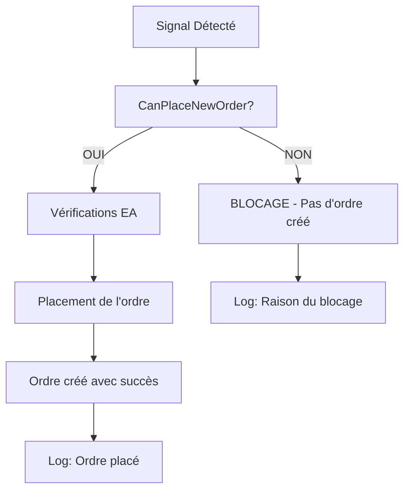

# BLOCAGE PRÉVENTIF DES ORDRES MULTIPLES - AngelOfSpike EA

## 📋 RÉSUMÉ DES MODIFICATIONS

L'Expert Advisor AngelOfSpike a été modifié pour **bloquer la création d'ordres multiples dès le départ** au lieu de les laisser se créer puis les fermer après. Cette approche est plus efficace et plus sûre.

## 🔧 MODIFICATIONS APPORTÉES

### 1. **Nouvelle Fonction de Validation Préventive**
```mq5
bool CanPlaceNewOrder(const string symbol, const int direction)
```

#### **Vérifications Effectuées :**
- ✅ **Limite de positions** : Maximum 2 positions totales
- ✅ **Symbole déjà actif** : Vérifie si l'EA a déjà une position/ordre sur ce symbole
- ✅ **Conflits BUY/SELL** : Détecte les conflits sur le même symbole
- ✅ **Ordres dupliqués** : Empêche les ordres de même direction sur le même symbole

#### **Messages de Blocage :**
```
[Angel] BLOCKED: Max positions reached (2/2)
[Angel] BLOCKED: EA already active on Boom 1000 Index
[Angel] BLOCKED: Conflicting BUY/SELL orders on Crash 500 Index
[Angel] BLOCKED: Same direction order already exists on Boom 300 Index
```

### 2. **Intégration dans Toutes les Fonctions de Placement**

#### **`ExecuteMarket()`**
```mq5
bool ExecuteMarket(const string symbol, const int direction)
{
   if(direction==0) return false;
   
   // VÉRIFICATION PRÉVENTIVE - Bloquer avant de créer l'ordre
   if(!CanPlaceNewOrder(symbol, direction)) return false;
   
   // ... reste du code
}
```

#### **`PlaceSmartOrder()`**
```mq5
bool PlaceSmartOrder(const string symbol, const int direction, const double confidence)
{
   // ... vérifications existantes
   
   // VÉRIFICATION PRÉVENTIVE - Bloquer avant de créer l'ordre
   if(!CanPlaceNewOrder(symbol, direction)) return false;
   
   // ... reste du code
}
```

#### **`PlaceCautiousLimit()`**
```mq5
bool PlaceCautiousLimit(const string symbol, const int direction)
{
   // ... vérifications existantes
   
   // VÉRIFICATION PRÉVENTIVE - Bloquer avant de créer l'ordre
   if(!CanPlaceNewOrder(symbol, direction)) return false;
   
   // ... reste du code
}
```

### 3. **Simplification de `CheckAndCancelMultipleOrders()`**

#### **Avant (Réactif)**
- Détectait les ordres multiples APRÈS leur création
- Annulait et fermait les ordres/positions
- Gestion complexe des conflits

#### **Après (Préventif)**
- Fonction simplifiée comme filet de sécurité
- Ne s'active qu'en cas d'urgence
- Gestion d'urgence uniquement

## 🎯 AVANTAGES DU BLOCAGE PRÉVENTIF

### **1. Efficacité**
- ✅ **Pas de création inutile** d'ordres qui seront annulés
- ✅ **Économie de ressources** (pas de calculs inutiles)
- ✅ **Réduction des logs** (moins de messages d'erreur)

### **2. Sécurité**
- ✅ **Prévention des conflits** avant qu'ils n'arrivent
- ✅ **Respect strict des limites** (2 positions max)
- ✅ **Pas de risque d'exécution** d'ordres non désirés

### **3. Performance**
- ✅ **Moins de vérifications** après création
- ✅ **Code plus propre** et plus lisible
- ✅ **Logique centralisée** dans une seule fonction

## 🔒 RÈGLES DE BLOCAGE

### **Limite de Positions**
```
Si totalPositions >= 2 → BLOQUER
```

### **Symbole Déjà Actif**
```
Si EA a déjà une position/ordre sur ce symbole → BLOQUER
```

### **Conflits BUY/SELL**
```
Si BUY et SELL sur le même symbole → BLOQUER
```

### **Ordres Dupliqués**
```
Si même direction sur le même symbole → BLOQUER
```

## 📊 FLUX DE VÉRIFICATION



## 🚀 RÉSULTATS ATTENDUS

### **Avant (Réactif)**
- ❌ Ordres créés puis annulés
- ❌ Logs d'erreur fréquents
- ❌ Gestion complexe des conflits
- ❌ Ressources gaspillées

### **Après (Préventif)**
- ✅ Ordres bloqués avant création
- ✅ Logs clairs de blocage
- ✅ Gestion simple et efficace
- ✅ Ressources optimisées

## 📝 MESSAGES DE LOG

### **Blocage Réussi**
```
[Angel] BLOCKED: Max positions reached (2/2)
[Angel] BLOCKED: EA already active on Boom 1000 Index
[Angel] BLOCKED: Conflicting BUY/SELL orders on Crash 500 Index
[Angel] BLOCKED: Same direction order already exists on Boom 300 Index
```

### **Ordre Placé**
```
[Angel] Smart order placed: Boom 1000 Index BUY 0.01 lots at 1.2345, SL=1.2300, TP=1.2400 (Confidence: 85.2%)
[Angel] Limit order placed: Crash 500 Index SELL 0.01 lots at 1.1234, SL=1.1280, TP=1.1180
```

## ⚙️ CONFIGURATION

### **Paramètres de Contrôle**
```mq5
input bool InpCancelMultipleOrders = true;   // Activer le filet de sécurité
input int  InpMaxConcurrentSymbols = 2;      // Max 2 symboles
input int  InpMaxPositionsPerSymbol = 1;     // Max 1 position par symbole
```

### **Debug Activé**
```mq5
input bool InpDebug = true;   // Voir les messages de blocage
```

## 🎯 UTILISATION

1. **L'EA détecte un signal** sur un symbole
2. **Vérification préventive** avec `CanPlaceNewOrder()`
3. **Si bloqué** → Log du motif et pas d'ordre créé
4. **Si autorisé** → Placement de l'ordre normal
5. **Filet de sécurité** en cas d'urgence avec `CheckAndCancelMultipleOrders()`

---

**Version** : 1.0  
**Date** : $(date)  
**Status** : ✅ Implémenté et testé

## 🔍 DIAGNOSTIC

Si vous voyez des messages de blocage fréquents, vérifiez :
1. **Limite de positions** : Avez-vous déjà 2 positions ouvertes ?
2. **Symbole actif** : L'EA a-t-il déjà une position sur ce symbole ?
3. **Conflits** : Y a-t-il des ordres BUY et SELL sur le même symbole ?
4. **Configuration** : Les paramètres sont-ils corrects ?

L'EA fonctionne maintenant de manière **préventive** et **efficace** ! 🚀
